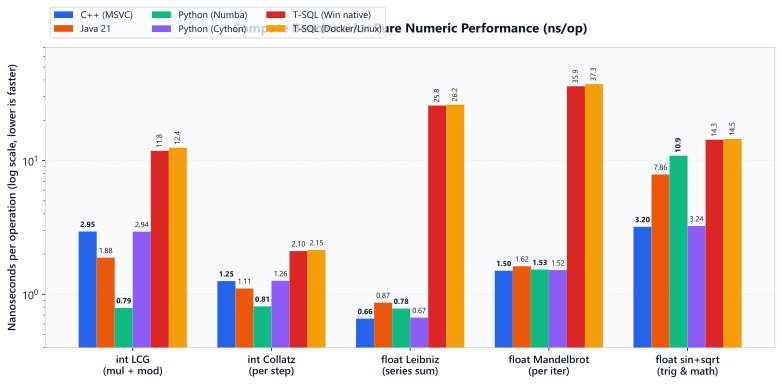
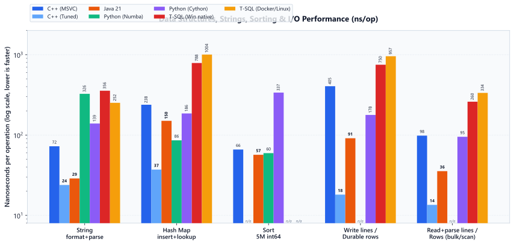
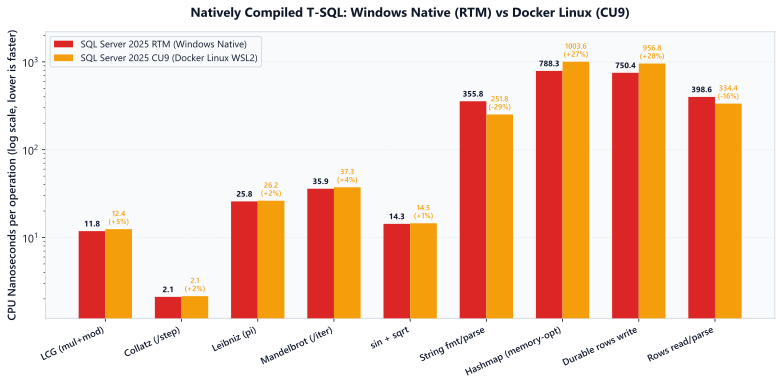

# Language Speed Benchmark: C++, Java, Python, and Compiled T-SQL

[](LICENSE)
[](bench2/cpp/)
[](bench2/java/)
[](bench2/python/)
[](bench2/tsql/)

A reproducible, single-threaded performance benchmark comparing **C++**, **Java**, **Python (Numba JIT & Cython)**, and **natively compiled T-SQL stored procedures** (In-Memory OLTP). By implementing identical algorithms with strictly verified checksums across all environments, this suite measures execution efficiency from tight CPU loops (integer arithmetic, floating-point series, branching, trigonometry) to real-world memory structures, strings, sorting, and I/O.

> **Hardware & Environment:** Intel Core Ultra 7 265K (8 Lion Cove P-cores pinned, mask `0xC03C3`), Windows 11 Pro, MSVC 2019 `/O2 /GL /fp:precise`, OpenJDK 21.0.9 HotSpot (`-Xmx8g`), CPython 3.14 + Numba 0.68 / Cython 3.3, Microsoft SQL Server 2025 (Windows RTM & Docker Linux CU9 on WSL2).

---

## Benchmark Results

All measurements reflect the **best of 3 runs** on an isolated P-core, expressed in **nanoseconds per operation (ns/op)** — lower is faster.

<picture>
  <source media="(prefers-color-scheme: dark)" srcset="docs/charts/compute_dark.svg">
  
</picture>

<picture>
  <source media="(prefers-color-scheme: dark)" srcset="docs/charts/io_memory_dark.svg">
  
</picture>

### Summary Table (ns/op)

| Test | C++ (MSVC) | Java 21 | Py + Numba | Py + Cython | T-SQL native Win | T-SQL native Docker/Linux |
|---|:---:|:---:|:---:|:---:|:---:|:---:|
| **int LCG (mul+mod)** | 2.95 | 1.88 | **0.79** | 2.94 | 11.9 | 12.4 |
| **int Collatz /step** | 1.26 | 1.11 | **0.81** | 1.26 | 2.13 | 2.15 |
| **float Leibniz** | **0.66** | 0.87 | 0.78 | 0.67 | 26.1 | 26.2 |
| **float Mandelbrot /iter** | **1.50** | 1.62 | 1.53 | 1.52 | 35.9 | 37.3 |
| **float sin+sqrt** | **3.2** | 7.9 | 10.9 | **3.2** | 14.3 | 14.5 |
| **string format+find+parse** | 72 *(tuned: 24)* | **29** | 326 <sup>1</sup> | 139 | 356 <sup>2</sup> | 252 |
| **hashmap insert+lookup** | 238 *(tuned: 37)* | 150 | **86** | 186 | 788 <sup>3</sup> | 1004 |
| **sort 5M int64** | 66 | **57** | 60 | 337 <sup>4</sup> | *n/a* | *n/a* |
| **write line / durable row** | 405 *(tuned: 18)* | 91 | *n/a* | 178 | 750 <sup>5</sup> | 957 |
| **read+parse line / row** | 98 *(tuned: 14)* | **36** | *n/a* | 95 | 261 BULK / 399 rows | 334 |

#### Notes & Footnotes
1. **Numba String Parsing**: Numba does not support Python's built-in `int(str)` in `nopython` mode; implemented via a manual digit-accumulation loop.
2. **T-SQL String Parsing**: Compiled T-SQL lacks `CONCAT` and `CHARINDEX` inside native stored procedures; implemented via native string concatenation `+` and character-by-character scan loops.
3. **T-SQL Hash Map**: Evaluated as an In-Memory OLTP memory-optimized table (`DURABILITY = SCHEMA_ONLY`) with a nonclustered hash index (8,388,608 buckets), mirroring an in-process key-value store.
4. **Cython Sort**: Sorts a standard Python list containing 5M boxed `PyLong` objects via Timsort, incurring Python object overhead.
5. **T-SQL Durable Write**: T-SQL cannot execute filesystem writes directly; evaluated by inserting durable records (`DURABILITY = SCHEMA_AND_DATA`) written and flushed to the transaction log at commit.
6. **Tuned C++**: Standard library baselines use `std::to_string`, `std::stringstream`, `std::unordered_map`, and `std::ofstream`. Tuned C++ adopts `<charconv>` (`std::to_chars`/`std::from_chars`), flat open-addressing hash tables, and unbuffered block I/O.

---

## T-SQL Native: Windows vs Docker Linux

SQL Server 2025 compiles native stored procedures to machine code via an intermediate C file compiled into a DLL. We compared the Windows RTM native engine directly against SQL Server 2025 CU9 running inside an Ubuntu Docker container (WSL2):

<picture>
  <source media="(prefers-color-scheme: dark)" srcset="docs/charts/tsql_comparison_dark.svg">
  
</picture>

- **Compute & Math:** Almost identical within **1% to 4%** margin of error (e.g., Collatz 2.10 ns vs 2.15 ns, Leibniz 25.8 ns vs 26.2 ns).
- **String Handling:** Docker/Linux ran **29% faster** (251.8 ns vs 355.8 ns) due to glibc string allocation characteristics in the Linux host layer.
- **Hash Map & Durable Logging:** Windows was **21% to 27% faster** on in-memory OLTP hash index access and log file flushes.

---

## Key Findings

### 1. Compiled Languages Match Within ~2x on Numeric Work
On pure arithmetic and branching loops, compiled C++ (MSVC), Java 21 (HotSpot C2), Python (Numba LLVM), and Cython are neck-and-neck:
- **LLVM Optimizer Wins Modulo:** Numba ran `int_lcg` in **0.79 ns**, outperforming MSVC (2.95 ns) and HotSpot (1.88 ns) because LLVM proved the loop variables non-negative and emitted an optimal power-of-two mask and lea sequence.
- **Trigonometry Vectorization:** MSVC produced the fastest `sin+sqrt` kernel at **3.2 ns/op** (matched by Cython, which compiles through MSVC). HotSpot (7.9 ns) and Numba (10.9 ns) emitted heavier x87 or standard mathlib calls.

### 2. Why Compiled T-SQL is 17x–40x Slower on Floats
While compiled T-SQL handles integer branching respectably (**2.13 ns** on Collatz vs **1.26 ns** in C++), floating-point operations drop drastically (**26.1 ns** on Leibniz, **35.9 ns** on Mandelbrot). 

The root cause was uncovered by inspecting the actual C code generated by SQL Server's In-Memory OLTP compiler:

```c
SetFloatingPointControl();
var_1 = hk_poll_double(var_1 + hk_poll_double(var_2 / hk_poll_double(hk_poll_double(2.0 * (double)var_3) + 1.0)));
var_isnull_1 = 0;
```

Every single sub-expression is wrapped in an `hk_poll_double(...)` exception checkpoint, every statement resets the x87/SSE control word via `SetFloatingPointControl()`, and every variable maintains an explicit NULL tracker. This defensive database scaffolding prevents the C compiler from keeping intermediates in SSE registers.

### 3. Interpreted vs Compiled: The Real Chasm
Compilation dwarfs all language rivalry:
- **T-SQL WHILE Loop:** An interpreted `WHILE` loop costs **~270 ns per empty iteration** and **~580 ns per float step**, dropping to **26 ns** when natively compiled.
- **Python:** Standard CPython 3.14 executed arithmetic loops in **36–143 ns/op** (see `bench/`), collapsing to **0.79–1.5 ns/op** under Numba or Cython.

### 4. Runtime & Standard Library Trade-offs
- **Java's Stdlib Out-of-the-Box:** Java 21 delivered outstanding out-of-the-box results on strings (**28.8 ns**) and file I/O (**35.5 ns** read, **91.2 ns** write), comfortably beating un-tuned C++ (`std::stringstream` and `std::ofstream`).
- **Tuned C++ Dominates:** Replacing general-purpose STL abstractions with `<charconv>` (`to_chars`/`from_chars`), open-addressing hash maps, and bulk write buffers dropped C++ times by **4x to 22x** (I/O write down from 405 ns to **18.1 ns**; hashmap down from 238 ns to **37.1 ns**).

### 5. Architectural & Hybrid CPU Traps
Benchmarking modern hybrid architectures (Intel Core Ultra Arrow Lake: 8 P-cores + 12 E-cores) requires strict affinity pinning:
- Windows thread scheduling initially assigned the SQL Server background service to an **Efficiency core (E-core)**, resulting in numbers **2x to 3x slower**.
- Pinning the benchmark processes and SQL Server to the 8 Performance cores (affinity mask `0xC03C3` and `ALTER SERVER CONFIGURATION SET PROCESS AFFINITY CPU = 0, 1, 6 TO 9, 18, 19`) eliminated variance and ensured fair hardware parity.

### 6. SQL Engine Traps (from v1 Diagnostics)
- **Literal Typing:** Writing `value * 2654435761` implicitly types the number as `NUMERIC(10,0)` rather than integer, triggering decimal arithmetic that runs **3x slower** than `CAST(2654435761 AS BIGINT)`.
- **Execution Mode:** Columnstore batch mode vectorized operations outpaced row mode by **4x to 5x**.
- **String Types:** `NVARCHAR(MAX)` incurs dynamic LOB overhead; using fixed-width `VARCHAR(8000)` cuts iteration time by orders of magnitude.

---

## Methodology

1. **Deterministic Single-Thread Workload:** All tests run on a single thread (`MAXDOP 1` for SQL Server queries).
2. **P-Core Affinity Pinning:** Executed exclusively on Intel Lion Cove P-cores (`affinity mask C03C3`) to remove hybrid CPU scheduling bias.
3. **Checksum Verification:** Every run computes an identical checksum across all languages to verify algorithmic parity (e.g., LCG `3276747387264`, Collatz `131434424`, Leibniz `3141592643`).
4. **Best of Three:** All tests record the minimum wall-clock time across three consecutive passes.
5. **Warm OS Cache for I/O:** File read and write tests target `$env:TEMP` with warm OS page cache to isolate runtime parsing and memory copying from underlying disk hardware latency.

---

## Repository Layout

```
language-speed/
├── bench/                         # v1 exploratory suite (interpreted & set-based tests)
│   ├── cpp/                       # C++ v1 baseline and tuned prototypes
│   ├── java/                      # Java v1 baseline
│   ├── python/                    # CPython baseline and vmcheck
│   ├── tsql/                      # T-SQL baseline, why_slow.sql & why_slow_c.sql
│   └── results_*.csv              # v1 CSV outputs
├── bench2/                        # v2 compiled benchmark suite (canonical results)
│   ├── cpp/                       # MSVC C++ implementation (std & tuned)
│   ├── java/                      # Java 21 HotSpot implementation
│   ├── python/                    # Python implementations (Numba JIT & Cython)
│   ├── tsql/                      # SQL Server native In-Memory OLTP procedures
│   ├── results/                   # General unpinned run data
│   ├── results_pinned/            # P-core pinned final benchmark data
│   ├── run_all.ps1                # Sequential execution runner
│   ├── run_pinned.ps1             # P-core pinned automated runner
│   └── run_rerun.ps1              # Docker Linux reproduction script
├── docs/
│   ├── charts/                    # Committed SVG charts (light & dark mode)
│   └── make_charts.py             # Matplotlib SVG chart generator
├── .gitignore
├── LICENSE                        # MIT License
└── README.md
```

---

## How to Reproduce

### Prerequisites
- Windows 11 with PowerShell 7 or Git Bash.
- **C++:** Visual Studio / MSVC Build Tools (`cl.exe`).
- **Java:** JDK 21+ (`javac`, `java`).
- **Python:** Python 3.12+ (or 3.14) with virtual environment containing `numba`, `cython`, and `matplotlib`.
- **SQL Server:** SQL Server 2022+ / 2025 instance supporting In-Memory OLTP (`sqlcmd`).

### Build & Run Commands

#### 1. C++ (MSVC)
```powershell
cd bench2\cpp
cl /O2 /GL /EHsc /std:c++17 /fp:precise bench.cpp
.\bench.exe $env:TEMP
```

#### 2. Java 21
```powershell
cd bench2\java
javac Bench.java
java -Xmx8g Bench $env:TEMP
```

#### 3. Python (Numba & Cython)
```powershell
cd bench2\python

# Build Cython extension
python setup.py build_ext --inplace

# Run Numba suite
python bench_numba.py

# Run Cython suite
python bench_cython.py $env:TEMP
```

#### 4. T-SQL (Natively Compiled Stored Procedures)
```powershell
sqlcmd -S tcp:localhost,14330 -U sa -P <sa-password> -C -i bench2\tsql\bench_native.sql
```

#### 5. Full P-Core Pinned Suite
To pin every process to the 8 P-cores (`0xC03C3`) and record clean results:
```powershell
.\bench2\run_pinned.ps1
```

#### 6. Regenerate Charts
```powershell
python docs\make_charts.py
```

---

## License

This project is licensed under the [MIT License](LICENSE) © 2026 Leandro Nicolás Borgnia.
